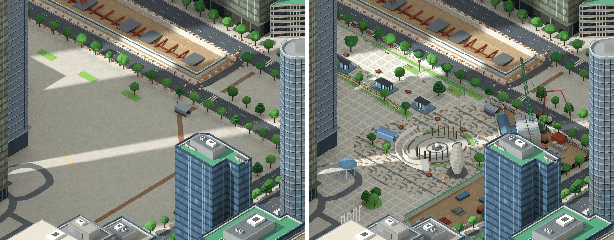
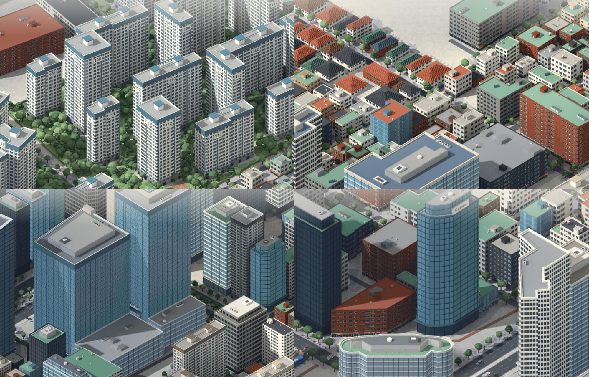
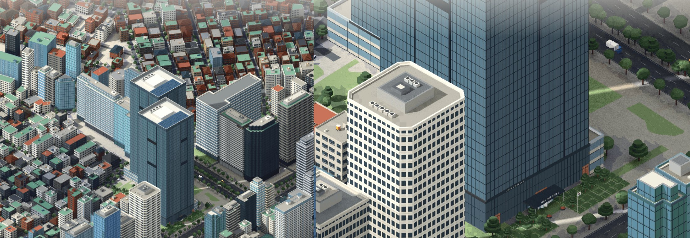
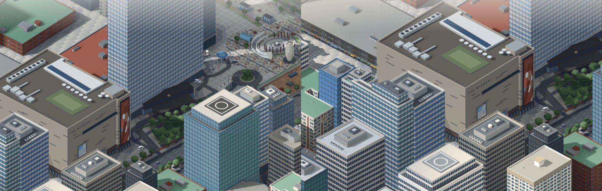

# 서울 미니어처 · Seoul Miniature

**경복궁과 여의도를 실제 지도 배치 그대로 옮긴, 살아 움직이는 픽셀아트 미니어처.**
시간·계절·날씨가 바뀌고, 사람과 자전거와 차가 돌아다닙니다. 브라우저에서 바로 열립니다.

**[▶ 경복궁 보기](https://midagedev.github.io/seoul-miniature/) · [▶ 여의도 보기](https://midagedev.github.io/seoul-miniature/?map=yeouido) · [▶ 테헤란로 보기](https://midagedev.github.io/seoul-miniature/?map=teheran) · [3D 장면 받기](https://github.com/midagedev/seoul-miniature/releases) · [만든 방법](docs/PIPELINE.md) · [쓴 프롬프트](docs/PROMPTS.md) · [가져다 쓰기](docs/REUSE.md)**


| 경복궁 | 여의도의 밤 |
|---|---|
|  |  |


## 한눈에

- **진짜 배치**: OpenStreetMap 의 건물·도로·강·공원으로 Blender 3D 장면을 코드로 세웠습니다. 경복궁 전각 46건은 국가유산청 3D 기록, 63빌딩·파크원·국회의사당 같은 랜드마크는 사진을 눈으로 보며 모델링했습니다.
- **그림체만 AI**: 3D 렌더를 270조각으로 나눠 이미지 편집 모델(Qwen-Image-Edit-2511, Apache-2.0)로 픽셀아트 그림체만 입혔습니다. 모델이 지어낸 건물은 렌더와 비교해 지웠습니다(여의도 497개 → 4개).
- **살아 있는 화면**: 사람 수천 명, 한강 자전거, 차 2,500대, 밤 창문 불빛, 비·눈·구름 그림자. 확대하면 6.25–12.5 cm/px 까지 세밀해집니다.
- **전부 공개**: 뷰어 코드(MIT), 그림(CC BY 4.0), 3D 장면 `.blend`·`.glb`(ODbL), 그림을 만든 스크립트와 프롬프트 원문까지. 출처만 밝히면 영상·게임·굿즈 등 어디에나 가져다 쓸 수 있습니다.

<details>
<summary><b>English</b></summary>

A living pixel-art miniature of two Seoul neighbourhoods: the Gyeongbokgung Palace district and Yeouido on the Han River. Time of day, seasons and weather change; thousands of people, bikes and cars move around.

- Each map is laid out from open map data (OpenStreetMap; Korea Heritage Service 3D records for 46 palace halls) as a Blender 3D scene and rendered with one fixed orthographic camera.
- The render is cut into 270 overlapping windows and restyled with an Apache-2.0 image-edit model (Qwen-Image-Edit-2511 + Lightning LoRA); whatever the model invents is checked against the render and undone.
- The browser viewer (WebGL2, no build step) uses depth and class maps from the same render to hide cars behind buildings and to animate trees, water, window lights and weather.
- **Reuse it**: pictures are CC BY 4.0, scene data and the Blender/glTF scenes are ODbL 1.0 ([Releases](https://github.com/midagedev/seoul-miniature/releases)), code is MIT. The exact prompts and scripts are in `docs/PROMPTS.md` and `pipeline3d/`. Documentation is in Korean.

</details>

## 테헤란로

강남역에서 삼성역까지 테헤란로 3.3 km 와 그 둘레(화면 3440 × 2120 m)를 한 장에 담았습니다. 강남역·역삼역·선릉역·삼성역, 선릉과 정릉(봉분 언덕·정자각·홍살문), 위워크타워, 포스코센터, 강남파이낸스센터, GT타워, 삼성 서초사옥, 코엑스·트레이드타워가 들어 있습니다. 삼성역 일대는 지금 모습대로 공사 현장입니다: 현대차 GBC 터에는 골조가 올라오는 코어와 타워크레인, 영동대로에는 복합환승센터(GTX) 굴착 구간의 버팀보·복공판·가림벽이 있습니다. 삼성역 5·6번 출구 앞 광장(코엑스 동측 광장)에는 밀레니엄 광장의 원형 광장(강철 기둥과 은빛 구), 지하 상가로 내려가는 초승달꼴 계단과 흰 난간벽, 달걀꼴 은회색 조형탑, 여러 색 돌 모자이크 판석, 못 가운데 선 줄무늬 파빌리온, 화단과 꽃 화분, 호텔 앞 깃대, 모퉁이의 공사 야적장(벽화 담장·접이식 출입문·크롤러 크레인·펌프카)이 있고, 사진 찍는 사람과 거리 음악가가 모입니다.



삼성역 광장. 왼쪽은 OSM 만으로 그린 처음 판(빈 바닥), 오른쪽은 거리뷰와 위성 사진을 보고 채운 지금 판입니다.

- 만드는 틀은 여의도와 같습니다(OSM → Blender 장면 → 고정 카메라 렌더 → 굽기). 카메라는 남남서쪽에서 북북동쪽을 봅니다(강남역이 왼쪽 아래, 삼성역이 오른쪽 위). 그림은 15.6 cm/px, 지도 1 px 는 1.25 m 입니다.
- **양식 패스(이미지 모델)를 거치지 않았습니다.** 이 지도의 그림은 3D 렌더를 128색으로 줄인 것 그대로라서, 경복궁·여의도의 픽셀아트 결과는 결이 다릅니다(벽돌·간판 같은 손그림 세부가 없습니다). GPU 로 양식 패스를 돌리면 같은 조건 렌더에서 이어서 구울 수 있습니다(`pipeline3d/teheran/build_assets_th.py --raw`).
- OSM 에 건물이 비어 있던 블록은 Overture 건물 테마의 East Asian Buildings 풋프린트 1,429개로 채웠고, 높이 태그가 없는 건물은 종류·면적·큰길 접함으로 추정했습니다.
- 랜드마크의 색과 입면 구성은 네이버 지도 거리뷰를, 옥상(헬리패드 유무·바닥 색, 강남파이낸스센터의 층층이 물러나는 꼭대기, 센터필드의 태양광 판, 메리츠타워·트레이드타워의 초록 바닥)은 위성 사진을 눈으로 보고 맞췄습니다(사진은 저장소에 없습니다). 옥상 설비의 정확한 자리와 메리츠타워의 입면은 추정입니다. 공사 현장의 장비·골조 배치는 연출입니다.

*왼쪽 위부터: 동 번호를 단 아파트 단지와 정원, 기와지붕 주택과 빌라 골목, 포스코센터, 옥상에 Canon 간판을 단 캐논타워.*

- 일반 건물도 거리뷰에서 본 유형으로 세웠습니다(`pipeline3d/teheran/detail.py`). 주택가 골목 57곳, 아파트 단지 76곳의 정문 앞, 테헤란로 150 m 간격 23곳을 거리뷰로 보고, 랜드마크 옥상과 옛 단지 4곳은 위성 사진으로 대조했습니다. 본 것을 옮기는 단위는 셋입니다: 랜드마크와 간판 건물은 건물 하나씩, 아파트는 단지 하나씩(26곳), 주택가는 가장 가까운 본 골목(300 m 안)의 동네 단위(벽돌 다세대 동네, 새 다세대 동네, 단독주택 동네, 학원·가게 골목). 그 안에서 건물 하나하나의 벽 유형은 종류·크기·면한 길에 따라 고정 난수로 나눕니다(빌라·주택 1만여 채의 벽을 하나씩 맞춘 것은 아닙니다). 지붕은 건물마다 맞췄습니다: 20 m 이하 건물 10,500채 가운데 8,966채는 위성 화면에서 그 건물 윤곽 안의 색을 읽어 일곱 종류(초록 방수 바닥, 회색, 밝은 색, 짙은 색, 붉은 기와, 파란 지붕, 황토색) 가운데 하나로 정하고, 붉은 기와로 읽힌 건물은 경사 지붕으로 세웠습니다. 이 부분만은 눈이 아니라 스크립트(`pipeline3d/teheran/roof_classes.py`)가 읽었고, 옮긴 것은 색 자체가 아니라 종류입니다. 나무·그림자에 가려 읽지 못한 1,395채는 45 m 안의 가장 가까운 판독 건물을 따릅니다. 58 m 이상 타워 212채는 위성 화면을 건물마다 눈으로 보고 헬리패드 유무(43채)와 옥상 바닥 색을 표로 옮겼습니다(`detail.py` 의 `TOWER_ROOF`). 그 사이 높이의 건물과 아파트 동의 옥상은 규칙·단지 색입니다.
  - 빌라·주택: 화강석 판·붉은 벽돌·고동색 벽돌·흰 타일·짙은 타일·송판 노출 콘크리트 외벽, 벽돌 다세대의 층 띠·밑동 석재·돌출창과 꼭대기 기와 지붕, 1층 필로티 주차장이나 간판 띠를 단 가게, 옥상의 옥탑(계단실)·물탱크·실외기·태양광 판·화분. 단독주택 845채는 박공·우진각 기와 지붕이고, 그 가운데 809채에는 마당 담과 정원수를 둘렀습니다.
  - 아파트: 동을 단지(76곳, 501동)로 묶어 단지마다 같은 색을 씁니다. 76곳 가운데 64곳은 정문 앞 거리뷰에서 본 벽·띠 색을 그대로 씁니다(나머지는 나무에 가려 못 봤습니다). 옛 단지(층수 중앙값 15층 이하로 가름)는 계단실 세로띠·옥상 물탱크·동 앞뒤 지상 주차장(위성 사진의 은마·개포우성·역삼럭키·서초진흥), 새 단지는 석재 저층부·꼭대기 층 띠·기계실을 잇는 옥상 장식 틀과 정원. 측벽 위쪽의 동 번호는 OSM 건물 이름에서 읽었습니다. 단지 둘레에는 생울타리 담과 정문(문주)을 세웠습니다. 마당 배치는 규칙으로 만든 것이라 실제 조경과 다릅니다.
  - 센터필드: 거리뷰의 두 출입구와 위성 사진을 보고 따로 세웠습니다. 3층 높이 유리 로비, 짙은 캐노피와 그 위 CENTERFIELD 글자, 방풍실과 회전문, 면을 셋으로 나누는 세로 줄눈과 기계층 루버 띠, 옥상의 스크린 벽·태양광 판·냉각탑, 테헤란로 쪽 정원·깃대·화분과 JOSUN PALACE 글자, 언주로 쪽 계단 단·고리 조형물·광장을 따라 뻗은 유리 캐노피 띠, 뒤쪽 석재 포디움(차량 진입구와 CENTERFIELD | JOSUN PALACE 글자)과 웨스트 동쪽 저층부(언주로 쪽과 뒤쪽은 이 지도의 카메라에서 타워에 가립니다). 회전문은 확대한 거리뷰에서 웨스트 하나, 이스트 둘로 읽었고, 타워 윤곽은 네이버 지도 화면과 겹쳐 보아 OSM 과 맞는 것을 확인했습니다. 캐노피·정원·저층 날개의 치수와 줄눈·띠의 높이 비율은 추정입니다.

    
  - 타워(45 m 이상): 유리 커튼월·띠창·석재 격자·짙은 유리·세로 핀 다섯 유형과 선릉역 서쪽의 사선 격자 건물. 포스코센터는 테헤란로 쪽 두 동과 그 사이 유리 아트리움, 뒤쪽 저층부로 나눠 세웠습니다(깊이·높이 비례는 추정).
- **빈 바닥 채우기.** OSM 은 블록 안쪽을 거의 비워 둡니다(판의 약 25 % 가 아무것도 없는 바탕 지면이었습니다). 위성 화면에서 큰 빈터를 하나씩 보니 학교 운동장·언덕 숲·지상 주차장·도로변 녹지·인조잔디 구장이어서, 2 m 칸마다 지면 종류(나무·잔디·모래 마당·아스팔트·밝은 포장)를 읽어 넣었습니다(`pipeline3d/teheran/ground_kinds.py`, 스크립트 판독). 나무로 읽힌 칸에는 나무를 심고, 아스팔트에는 주차 칸을, 바탕 지면과 포장에는 판석 줄눈을 그렸습니다. 간선 도로는 OSM 에 차로 수 태그가 없어 한 방향 3차로 폭으로 들어가 있던 것을 실제 차로 수(테헤란로·강남대로 한 방향 5차로, 영동대로 7차로 등)로 넓혔습니다.
- 삼성역의 그랜드 인터컨티넨탈 서울 파르나스는 거리뷰·위성·일반 지도 화면을 보고 은청색 띠 유리 몸체, 브론즈색 현관동과 캐노피·금색 글자, 진입 차로·회차 로터리·생울타리 정원을 넣었고, 파르나스타워 모서리에 세로 전광판을 달았습니다. 현대백화점 무역센터점은 창문 격자 건물로 잘못 들어가 있던 것을 창이 거의 없는 베이지색 석재 상자(짙은 가로 홈, 화강석 저층부, 긴 띠창, 유리 현관, 벽면 포스터)와 옥상(하늘정원·파라솔 줄·냉각탑 줄·태양광 띠)으로 다시 세웠습니다(`pipeline3d/teheran/parnas.py`). 높이는 OSM 의 37 m 대신 지상 10층으로 보고 50 m 로 잡았습니다(추정).

  
- 간판은 거리뷰에서 글자를 읽을 수 있었던 것만 넣었습니다(`pipeline3d/teheran/signs.py`, `detail.py` 의 `TOWER_SIGNS`): 파르나스타워 꼭대기의 PARNAS, GS타워 옥상 원통의 GS, 현대백화점 벽의 THE HYUNDAI 와 세로 전광판, 위워크타워의 wework, 그리고 테헤란로 북쪽 변을 훑어 읽은 workflex(강남N타워), KR TOWER, ARTNOUVEAU CITY HOTEL, FASTFIVE, HOTEL PEYTO, Canon(캐논타워), SPARKPLUS, 강남역의 MEGABOX. 테헤란로 남쪽 변 건물의 간판은 길 쪽(북쪽)을 보고 있어 이 지도의 카메라에 보이지 않으므로 넣지 않았습니다. 글라스타워·포스코센터·코엑스의 간판과 코엑스 아티움 전광판도 장면에는 있지만, 이 지도의 카메라가 보지 않는 북·동쪽 면이거나 다른 건물에 가려 그림에는 나오지 않습니다. 글자를 읽지 못한 건물(아셈타워, 강남파이낸스센터, 메리츠타워 등)에는 넣지 않았습니다.
- 삼성역 광장은 OSM 에 상업 부지 한 덩어리로만 있어서, 윤곽을 네이버 지도 위성 사진에서 눈으로 따 오고(오차 2–3 m) 형태·높이·색은 거리뷰를 보고 정했습니다. 길 쪽(야적장 담장·출입문·흙더미·크레인, 호텔 앞)은 2026-07 촬영분, 광장 안쪽(원형 광장·계단·파빌리온·조형탑·판석)은 공사 전인 2017-08 보행 거리뷰를 따랐고, 그 가운데 지금 위성 사진에 그대로 남아 있는 것만 넣었습니다. 계단 깊이(실제 약 5 m → 1.4 m), 기둥 수, 야적장 안 장비·자재 배치는 연출입니다. 이 구역은 그 타일만 다시 렌더해 달라진 자리만 덧입혔습니다(`pipeline3d/teheran/patch.sh`).
- 스크립트와 순서는 [`pipeline3d/teheran/`](pipeline3d/teheran/run.sh), 출처는 [CREDITS.md](CREDITS.md)의 「테헤란로」에 있습니다.

## 어떻게 만들었나

1. **배치는 공개 데이터에서.** OpenStreetMap 의 건물 윤곽·높이 태그·도로·교량·수면·녹지·담·나무로 Blender 3D 장면을 코드로 세웁니다. 경복궁 일대는 국토교통부 건물 높이를 더했고, 전각 46건은 국가유산청이 공공누리 제1유형으로 개방한 3D 기록의 형태를 배치했습니다.
2. **랜드마크는 사진을 보고 모델링.** 63빌딩·파크원·국회의사당 같은 건물은 사진을 여러 각도로 눈으로 보고 코드로 만들었습니다. 사진은 모델에 넣지 않았습니다.
3. **고정 카메라로 조건 렌더.** 정사투영 카메라 하나(35° 내려다봄, 경복궁은 북서쪽·여의도는 남쪽을 봄)로 색·물체 ID·깊이를 22016 × 13568 px 캔버스에 렌더합니다.
4. **양식만 이미지 모델로.** 색 렌더를 1408 × 1024 px 창 270개(겹침 128 px)로 나눠, 창마다 그 창에 있는 것만 말하는 프롬프트로 다시 그립니다. 창들이 잠재값 하나를 함께 써서 이음매가 거의 없습니다. GPU 3장으로 지도 하나에 약 1시간(경복궁 67분, 여의도 59분) 걸렸습니다.

   
   *왼쪽부터 3D 렌더, 이미지 모델 결과, 최종 그림. 벽돌·간판·옥상 소품은 모델이 그렸습니다.*

5. **지어낸 것 되돌리기.** 모델은 빈 마당·강물·다리 위에 건물을 지어냅니다. 조건 렌더를 정답지로 그런 곳을 찾아 다시 칠합니다(여의도에서 지어낸 건물 497개 → 4개). 옥상과 랜드마크 벽은 렌더를 그대로 씁니다.

   
   *가운데: 모델이 63빌딩 옆 잔디밭에 벽돌집 두 채를 지어냈습니다. 오른쪽: 렌더와 비교해 지운 최종 그림.*

6. **줄이고 자르기.** 128색으로 줄이고 확대 단계별 256 px 타일로 자릅니다(지도당 약 6천 장, 90 MB 안팎). 같은 렌더의 깊이·ID 로 가림 판정용 깊이 맵과 분류 맵을 만듭니다.
7. **브라우저에서 살리기.** WebGL2 뷰어가 깊이 맵으로 차와 사람을 건물 뒤에 가리고, 분류 맵으로 나무 흔들림·물결·창문 불빛·구름 그림자·눈비를 셰이더에서 만듭니다. 사람·자전거·차·새는 코드로 그립니다.

## 따라 해 보기

| 읽을 것 | 내용 |
|---|---|
| [docs/PIPELINE.md](docs/PIPELINE.md) | 단계별 입력·출력·숫자·이유, 다른 지역에 적용하는 점검표 |
| [docs/PROMPTS.md](docs/PROMPTS.md) | 이미지 모델 프롬프트 원문과 조립 규칙, 판마다 바꾼 이유, Claude Code 에 한 지시 원문 |
| [docs/LESSONS.md](docs/LESSONS.md) | 안 됐던 것과 그 이유(3D 판, 이전 2D 판) |
| [pipeline3d/README.md](pipeline3d/README.md) | 지금 그림을 만든 스크립트, 환경 변수, 입력 자료 받는 곳, 실행 순서 |
| [docs/APP.md](docs/APP.md) | 뷰어 구조, 자산 형식, 주소 옵션 |
| [docs/REUSE.md](docs/REUSE.md) | 그림·장면·코드를 가져다 쓰는 조건, 그대로 복사하는 출처 문구, 용도별 안내 |
| [docs/LICENSING.md](docs/LICENSING.md) | 공개 전 라이선스 점검 방법과 결정 기록 |
| [docs/PIPELINE-2D-legacy.md](docs/PIPELINE-2D-legacy.md) | 이전 판(2D 색 블록 밑그림) 절차. `pipeline/` 의 도구가 이 판의 것 |

새 동네로 해 보려면 `pipeline3d/yeouido/` 경로를 본으로 삼으세요. OSM 받기부터 굽기까지 이어집니다. 입력 데이터(OSM 원본, 국가유산청 3D, 중간 렌더)와 모델 가중치는 이 저장소에 없습니다.

## 이 저장소에 있는 것

| 경로 | 내용 |
|---|---|
| `index.html`, `style.css`, `src/` | 뷰어. 빌드 없이 그대로 열리는 ES 모듈(WebGL2). GitHub Pages 가 저장소 루트를 그대로 서빙합니다 |
| `assets/` | 뷰어가 쓰는 그림 타일·깊이·분류 맵과 장면 데이터(경복궁 `redraw/`·`web-poc/`, 여의도 `yeouido/`, 테헤란로 `teheran/`) |
| `test/` | 교통·사람 시뮬레이션, 투영, 타일, PNG 디코더, 밤 창문, 지도 전환의 `node --test` 테스트 |
| `pipeline3d/` | 지금 그림을 만든 스크립트: 3D 장면·조건 렌더(Blender `bpy`), 양식 패스(ComfyUI 조정자·워커), 굽기 |
| `pipeline/` | 이전 판 그림을 만든 도구(OSM 받기 → 색 블록 밑그림 → 타일 생성 → 검사 → 병합) |
| `docs/` | 위 "따라 해 보기"의 문서들 |
| `CREDITS.md`, `LICENSE` | 출처와 라이선스 |

## 바로 실행

```bash
git clone https://github.com/midagedev/seoul-miniature && cd seoul-miniature
node serve.mjs 5173        # http://127.0.0.1:5173/  (의존성 없음), 여의도는 /?map=yeouido, 테헤란로는 /?map=teheran
npm install && npm test    # 테스트를 돌릴 때만
```

주소 옵션: `?map=yeouido` 여의도 · `?map=teheran` 테헤란로 · `?res=1` 절반 해상도 그림 · `?cars=150` 차량 수 · `?tilt=0` 미니어처 흐림 끄기 · `?tour` 자동 둘러보기 · `?clean` UI 숨김 ·
`#x,y,높이` 특정 위치로 바로 열기(화면 아래 「링크 복사」가 만들어 줍니다). 전체 목록은 [docs/APP.md](docs/APP.md).

## 한계

- 그림은 지도마다 정지 그림 한 벌입니다. 카메라는 돌릴 수 없고, 확대·이동만 됩니다.
- 양식 패스는 창 단위라서 창 경계에서 그림체가 조금 달라지는 곳이 있습니다. 모델이 지어낸 작은 소품이 남아 있을 수 있습니다.
- 가림 판정은 깊이 맵 한 장으로 합니다. 다리 밑이나 처마 밑처럼 겹친 곳에서는 틀릴 수 있습니다.
- 교통은 연출입니다. 경복궁은 신호와 차로를 따르고, 여의도는 신호 없이 차로만 따릅니다. 실제 교통량·신호 주기와는 무관합니다.
- 휴대폰에서는 화면 크기와 메모리에 맞춰 낮은 확대 단계의 타일을 씁니다. 기기별 프레임 속도는 측정해 공개한 값이 없습니다.

## 사실성에 대해

건물 배치는 공개 지도 데이터 기반이지만 측량 수준이 아닙니다. 여의도 건물 높이는 OSM 태그가 없으면 건물 종류와 면적으로 추정했습니다. 국가유산청 기록을 쓴 경복궁 전각 46건과 사진을 보고 만든 랜드마크 외의 파사드·지붕·창문·수목은 절차적으로 만들거나 AI 가 그린 장식이고, 사람과 차는 연출입니다.
지도로 쓰지 마세요.

## 가져다 쓰기


그림·타일·영상·스크린샷은 **CC BY 4.0**, 장면 데이터(`scene.json`, `map.json`)와 3D 장면(`.blend`, `.glb`)은 **ODbL 1.0**, 코드는 **MIT** 입니다. 영상·글·인쇄물·굿즈·게임에 써도 되고 고쳐서 다시 내도 됩니다(프로젝트는 비상업이지만 그림의 상업 이용도 허용합니다). 이 프로젝트와 원천(OpenStreetMap, 경복궁이면 국가유산청)을 함께 표시해 주세요.
3D 장면(Blender `.blend`, 게임 엔진·웹용 `.glb`, 여의도 랜드마크별 `.glb`)은 파일이 커서 [Releases](https://github.com/midagedev/seoul-miniature/releases)에 있습니다. 경복궁 장면에는 국가유산청 모델 대신 대체 모형이 들어 있고, 직접 받은 모델을 끼우는 스크립트가 있습니다.
복사해 쓰는 출처 문구, 용도별 안내, 실제 건물 생김새에 관한 주의는 [docs/REUSE.md](docs/REUSE.md).

## 출처와 라이선스

지도 데이터 © [OpenStreetMap contributors](https://www.openstreetmap.org/copyright) (ODbL) · Overture Maps Foundation · 국토교통부 GIS건물통합정보 · 국가유산청 경복궁 3D 기록(공공누리 제1유형) · 그림 Qwen-Image-Edit-2511 + Lightning 8-step LoRA (Apache-2.0).
위 기관·단체가 이 작업을 후원하거나 보증한 것은 아닙니다.

- 전체 출처와 조건: [CREDITS.md](CREDITS.md)
- 코드는 MIT, 그림은 CC BY 4.0, 장면 데이터는 ODbL: [LICENSE](LICENSE), 쓰는 법은 [docs/REUSE.md](docs/REUSE.md)
- 공개 전에 라이선스를 어떻게 점검했는지: [docs/LICENSING.md](docs/LICENSING.md)
